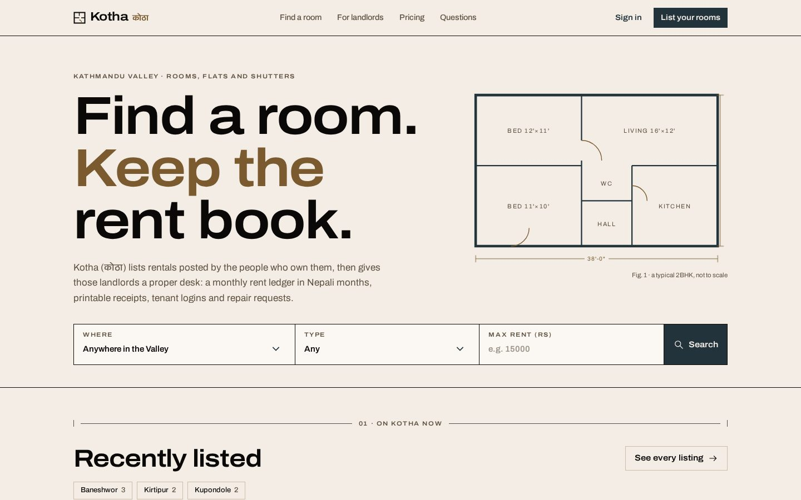
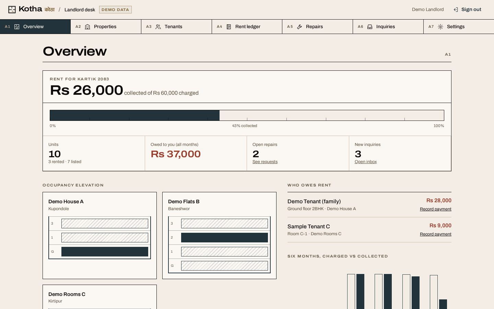
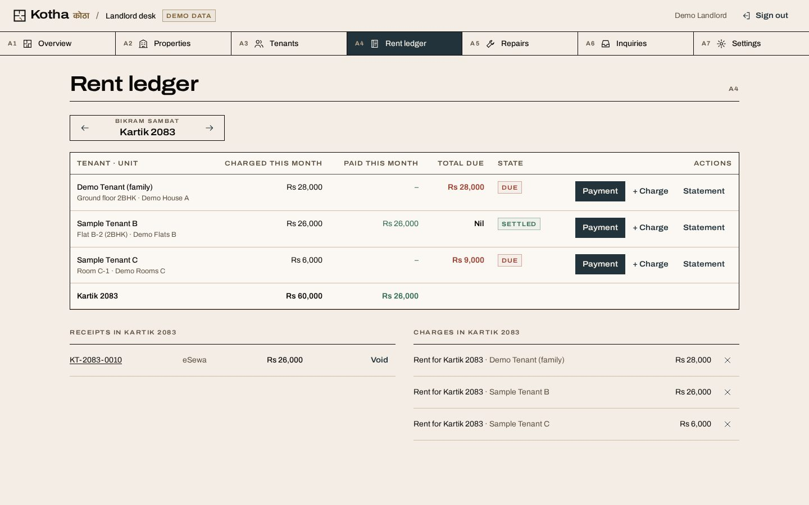
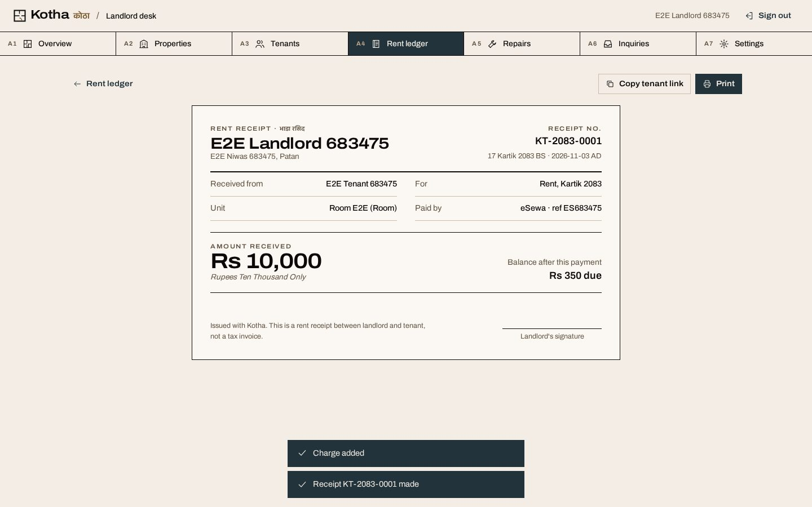
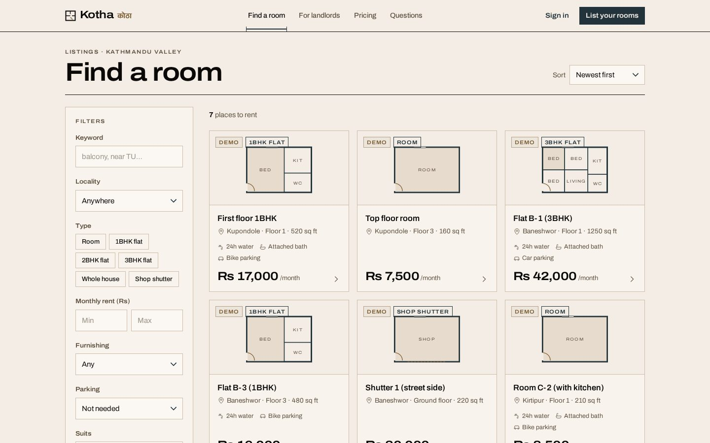
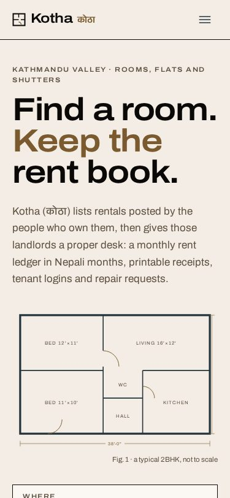
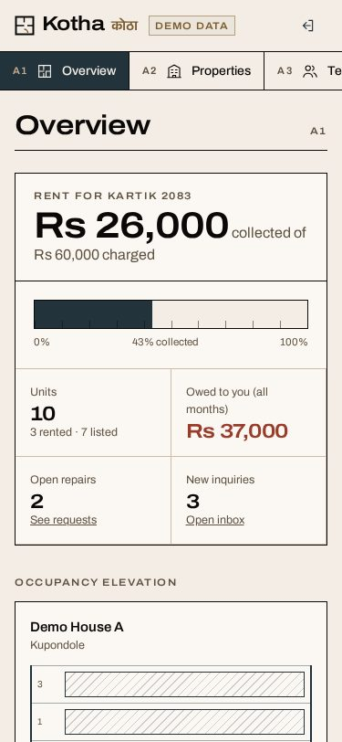
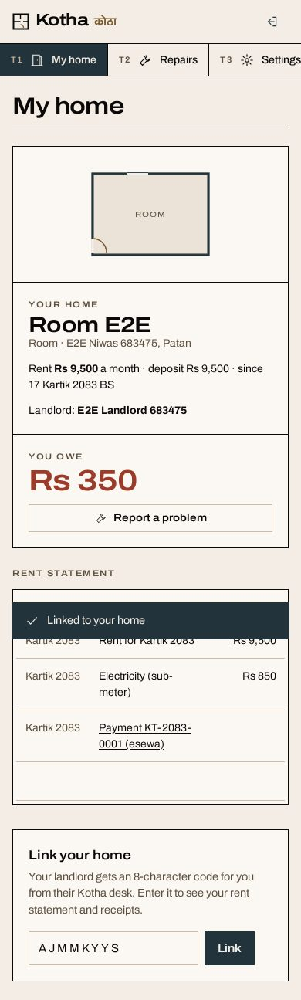

# Kotha (कोठा)

**Rooms and flats to rent in the Kathmandu Valley, plus a rent book for the people who own them.** Renters search listings with honest filters (area, type, rent, water, parking, who it suits) and send an inquiry without an account. Landlords get a desk: properties and units, tenants with login codes, a monthly rent ledger in Bikram Sambat months, numbered printable receipts, repair requests and an inquiry inbox. Tenants log in to see their statement and receipts and to report problems. A platform admin moderates listings and users.

Day 3 of Nabin's **100 Days · 100 Platforms**.

- **Live:** https://kotha-ktm.sites.tab.bot/
- **Demo:** https://kotha-ktm.sites.tab.bot/login?demo=1 has one-tap buttons for a sample landlord desk and a sample tenant page. Everything in the demo is labelled **Demo** and resets every 3 hours.



## What it does
- **Public listings:** search by keyword, locality, type (room, 1/2/3BHK, house, shop shutter), rent range, furnishing, parking, 24-hour water, attached bath and "suits" (students, families, working people, women only). Sort by newest or rent. Filters live in the URL, removable filter tokens, pagination, skeleton loaders and a helpful empty state. Rented units drop off automatically.
- **Listing page:** a plan sketch drawn from the unit type (Kotha never shows a photo that is not of the home), a spec sheet, the landlord's first name only, and an inquiry form with a honeypot and rate limit.
- **Landlord desk:** overview (collection meter for the BS month, owed amounts, occupancy elevation per building, six-month charged vs collected chart); properties and units (CRUD, list or unlist); tenants (CRUD, private notes, 8-character login code with a WhatsApp message, move-in and move-out); rent ledger (charge rent to all tenants for a BS month in one click, idempotent; add electricity, water, internet or other charges; record cash, bank, eSewa, Khalti, Fonepay or cheque payments; void with a reason; per-tenant statement with running balance); receipts (numbered `KT-2083-0001`, BS and AD date, amount in words, balance after payment, print/save as PDF, shareable link); repair requests (Open → In progress → Resolved → Closed with notes); inquiries (call, WhatsApp, mark replied or closed); settings.
- **Tenant page:** link a home with the landlord's code; balance, statement, receipts; raise and follow repair requests and close them once fixed.
- **Admin:** live counts, users (disable, which ends their sessions; switch Free/Pro), listing moderation (hide/unhide with reason), audit trail, demo reset.

| | |
|---|---|
|  |  |
|  |  |

<p>  </p>

## Stack
- React 18 + Vite + TypeScript + Tailwind CSS. No UI kit; Kotha's own drafting-pen icon set; lazy-loaded routes; a tiny history router.
- One **Cloudflare Worker** serves the API (`/api/*`) and the app; **Cloudflare D1** (SQLite) is the database. D1 replaces PostgreSQL/Prisma so the platform runs at **$0** on the free tier.
- Own auth: PBKDF2-SHA256 password hashes (WebCrypto), hashed session tokens in HttpOnly/Secure/SameSite cookies, same-origin JSON-only writes (CSRF), rate limits on sign-in, registration, inquiries and code linking, roles **tenant / landlord / admin** with per-row ownership checks.
- Bikram Sambat maths from Nabin's own [`nepali-date`](https://github.com/nabinbabuuranw/nepali-date) library (MIT), shared by API and browser (`shared/rent.ts`).
- Fonts: Archivo (variable width) and Anek Devanagari, SIL OFL, self-hosted.
- Palette: Coolors "Neutral Earth Tones" `#0A0908 #22333B #EAE0D5 #C6AC8F #5E503F` (see `docs/DESIGN.md`).

## Run it
```bash
npm install
npm test            # 13 API test groups (Node 22.6+, uses node:sqlite)
npm run build       # tsc + vite build + bundles the Worker into dist/site
```
`dist/site` is a Cloudflare Worker with static assets (`_worker.js`; `tab-site.json` declares one D1 binding `DB`). The schema and the demo data are created on first request. To create the first admin, POST `/api/setup` with a setup key whose SHA-256 matches `SETUP_KEY_SHA256` (set your own; the production key is not in this repo).

Live E2E (Python Playwright): `python3 e2e/e2e.py BASE_URL OUT_DIR creds.json` with `{"admin":{"email","password"}}`.

## Docs
- `docs/DESIGN.md`: research, UI UX Pro Max output, 21st.dev searches, Coolors palette, type, tokens, layout.
- `docs/BUSINESS.md`: customers, competitors, pricing (Free / Landlord Pro Rs 699 a month), acquisition, costs.
- `docs/QA_REPORT.md`: tests, live E2E, 30-point anti-AI audit, Lighthouse, known limits.

## Status
Expenses: $0. Revenue: Rs 0. Built 3 November 2026.

## License
MIT
